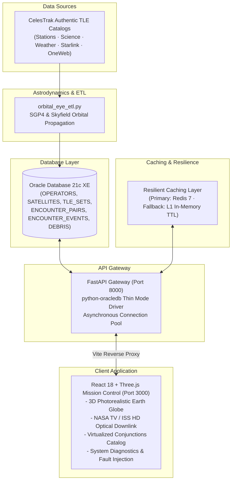

# 🛰️ OrbitalEye — Satellite Collision Avoidance & Space Traffic Management System
### DBMS Edition · Oracle 21c XE · FastAPI · React 18 · Three.js · SGP4 Astrodynamics

[](https://youtu.be/AuykokUP0FY)

> **📺 [Watch the Official 2-Minute Cinematic Showcase on YouTube](https://youtu.be/AuykokUP0FY)**

---

## 🌌 Overview

**OrbitalEye** is an enterprise-grade space traffic management and satellite collision prediction console. It monitors operational low-Earth orbit (LEO) satellites, detects high-risk conjunction events using SGP4 orbital propagation, calculates miss distances and collision probabilities according to NASA CARA standards, and displays real-time 3D planetary telemetry.

In 2009, the **Iridium 33 × Cosmos 2251** disaster produced over 2,000 pieces of trackable space debris that remain in orbit today. OrbitalEye provides relational database integrity, sub-millisecond query caching, and interactive 3D WebGL visualization to evaluate orbital risk across thousands of active space objects.

---

## 🚀 Quickstart Guide (How to Run the Project)

Whether you are running on **Windows**, **macOS**, or **Linux**, getting started takes less than two minutes.

### 📋 Prerequisites
- **Git** installed on your system.
- One of the following:
  - **Docker & Docker Desktop** (Recommended for cross-platform / zero-install setup), **OR**
  - **Python 3.10+**, **Node.js 18+**, and **Oracle Database 21c XE** (For native Windows execution).

---

### Method 1: Docker (Easiest — Cross-Platform)

Docker handles all dependencies automatically.

1. **Clone the repository**:
   ```bash
   git clone https://github.com/gokultn592-netizen/Hackathon-Projects.git
   cd "Hackathon-Projects/Orbital Eye"
   ```

2. **Copy the environment configuration**:
   ```bash
   # Windows Command Prompt:
   copy .env.example .env

   # macOS / Linux / PowerShell:
   cp .env.example .env
   ```

3. **Choose your launch mode**:

   * **Option A: You already have Oracle 21c XE running locally on your computer**:
     ```bash
     docker compose up --build
     ```
     *(The backend will seamlessly connect to your host machine's Oracle instance at `host.docker.internal:1521`)*.

   * **Option B: You do NOT have Oracle installed (All-in-One Docker Stack)**:
     ```bash
     docker compose --profile with-db up --build
     ```
     *(Docker will automatically download and start an Oracle Database container, initialize all tables and schemas from `database/ddl`, start Redis, launch the FastAPI backend, and serve the React frontend).*

4. **Open your browser**:
   - **Mission Control Dashboard**: [http://localhost:3000](http://localhost:3000)
   - **Interactive API Swagger Docs**: [http://localhost:8000/docs](http://localhost:8000/docs)
   - **Live System Diagnostics**: [http://localhost:8000/api/system/health-checker](http://localhost:8000/api/system/health-checker)

---

### Method 2: Native Windows One-Click Launcher

If you are on Windows with Oracle 21c XE, Python, and Node.js installed locally:

1. Double-click or execute:
   ```cmd
   run.bat
   ```
2. The automated launcher will:
   - Verify that `OracleServiceXE` is active.
   - Start the FastAPI backend on `http://localhost:8000` in the background.
   - Start the React Vite frontend on `http://localhost:3000` in the background.
   - Run live HTTP diagnostic probes on backend and database connectivity.
   - Automatically open `http://localhost:3000` in your default browser.

---

### Method 3: Manual Step-by-Step Local Development

If you prefer to run services manually in separate terminals:

1. **Setup Environment**:
   ```bash
   cp .env.example .env
   ```
   *(Ensure credentials match your Oracle user and password, e.g. `ORBITAL_EYE` / `OrbitalEye_2026`)*.

2. **Terminal 1 — Start Backend**:
   ```bash
   cd backend
   pip install -r requirements.txt
   python -m uvicorn main:app --host 0.0.0.0 --port 8000 --reload
   ```

3. **Terminal 2 — Start Frontend**:
   ```bash
   cd frontend
   npm install --legacy-peer-deps
   npm run dev
   ```

4. Navigate to [http://localhost:3000](http://localhost:3000).

---

## 🛠️ Architecture & Data Flow



---

## ⚡ Key Capabilities & Features

- **High-Fidelity 3D WebGL Visualization**:
  - Interactive, photorealistic Earth globe with atmosphere shaders, specular ocean reflections, cloud layers, and city nightlights.
  - SGP4 orbit paths and real-time positioning for active LEO spacecraft and space stations (ISS, Tiangong).
  - Dynamic risk classification shaders: Cyan (Nominal), Yellow (Caution), and Pulsing Red (Critical Conjunction).

- **Conjunction Analysis & B-Plane Geometry**:
  - In-browser interactive B-plane approach geometry diagram displaying miss distance ($d_{\text{miss}}$), relative velocity ($v_{\text{rel}}$), and time of closest approach (TCA).
  - NASA CARA-aligned risk threshold filters ($< 1.0\text{ km}$ Critical, $1.0 - 5.0\text{ km}$ Caution, $> 5.0\text{ km}$ Nominal).

- **Dual Telemetry Modes**:
  - `REALTIME`: Live Low Earth Orbit satellites and upcoming conjunction alerts.
  - `ACCIDENT`: Exact physics reconstruction of the 2009 Iridium 33 × Cosmos 2251 hypervelocity collision.

- **Enterprise Service Diagnostics Modal (`/services`)**:
  - High-density aerospace UI (inspired by SpaceX Dragon Avionics and Palantir Foundry).
  - Live Oracle 21c XE table audit counters (11,558+ satellites, 14,037+ encounters).
  - Real-time connection pool status and sub-millisecond query ping latency.
  - Developer **Fault-Injection Simulator** allowing you to cut or restore the database connection live to test UI resilience.

- **Integrated LEO Optical Downlink**:
  - Stream live video feeds from the International Space Station (ISS HD Live Earth View).

- **Keyboard Hotkeys**:
  - Press `?` or `K` to toggle the Keyboard Command HUD.
  - `Space`: Pause / Resume orbital time progression.
  - `R`: Reset camera perspective to default orbital view.
  - `O`: Toggle orbital trajectory paths.
  - `C`: Open Conjunction Catalog.
  - `H`: Open System Infrastructure Diagnostics.

---

## 💻 Technology Stack

| Layer | Technology | Role |
| :--- | :--- | :--- |
| **Database** | Oracle Database 21c XE | Relational storage with strict constraints, indexes, and connection pooling |
| **DB Driver** | `python-oracledb` | Official Oracle thin-mode driver (zero C-library or instant-client dependencies) |
| **Backend API** | FastAPI / Python 3.12+ | Asynchronous REST endpoints, CORS middleware, and system diagnostic probes |
| **Astrodynamics** | SGP4 / Skyfield | Pure Python orbital propagation and coordinate frame transformations (ECI $\rightarrow$ ECEF $\rightarrow$ Scene) |
| **Cache** | Redis 7 + In-Memory Fallback | Zero-downtime distributed caching with automated local memory TTL fallback |
| **Frontend** | React 18 / TypeScript / Vite | Mission control user interface and state management |
| **3D Engine** | Three.js / `@react-three/fiber` | Hardware-accelerated WebGL planetary and satellite rendering |
| **Containerization** | Docker & Docker Compose | Multi-container reproducible deployment |

---

## 🛑 Stopping & Cleaning Up Containers

When you are finished using Docker:
```bash
# Stop containers
docker compose down

# Stop containers and clean up Docker networks and volumes
docker compose down --volumes --remove-orphans
```
*(For complete cleanup options, see [DOCKER_CLEANUP.md](./DOCKER_CLEANUP.md))*

---

## 👥 The Team

**VIT Vellore — Integrated M.Tech Data Science**
* **Gokulnath**
* **Tamilmani**
* **Harish**

> *"Built with passion. Built to last."*
